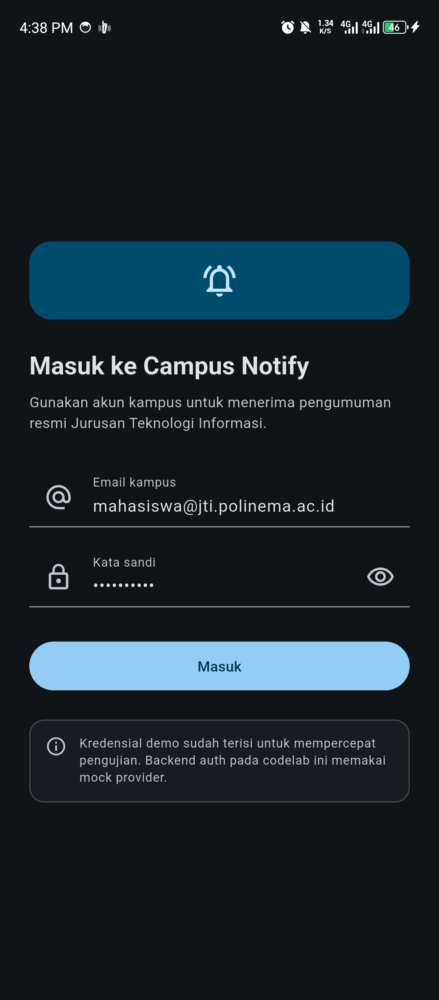
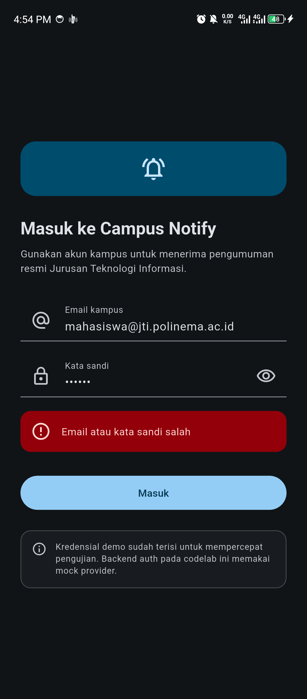
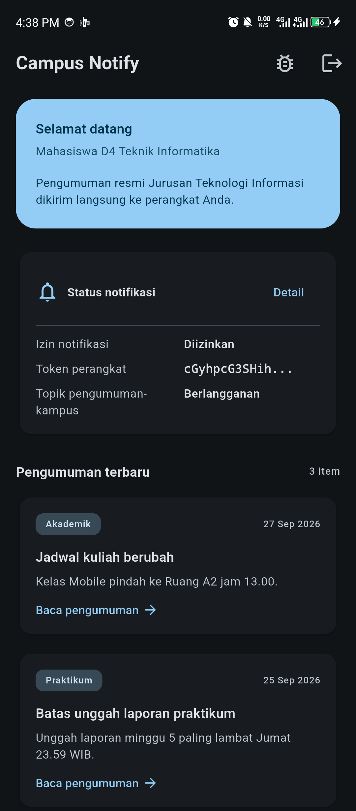
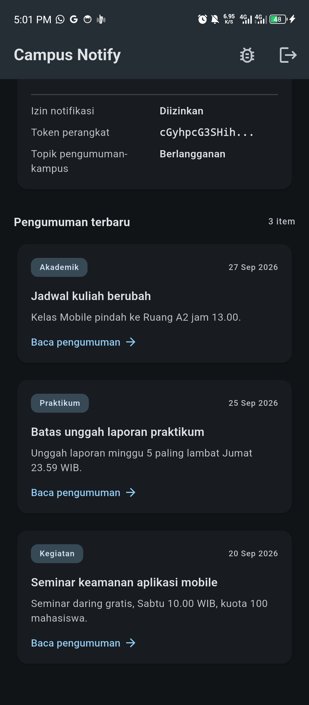
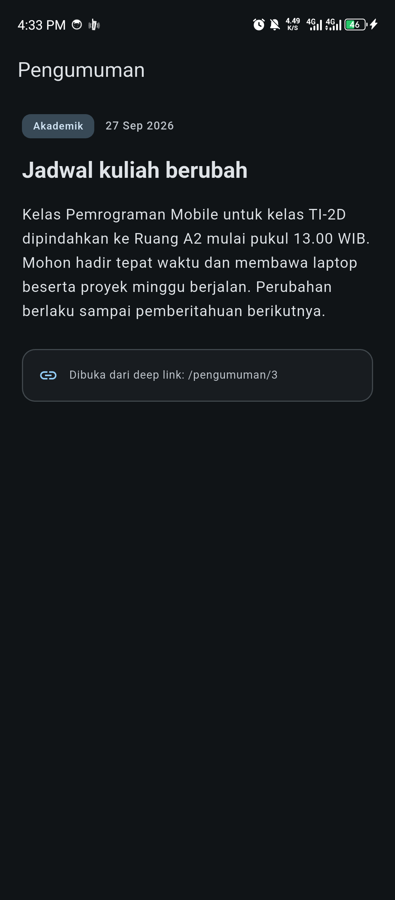
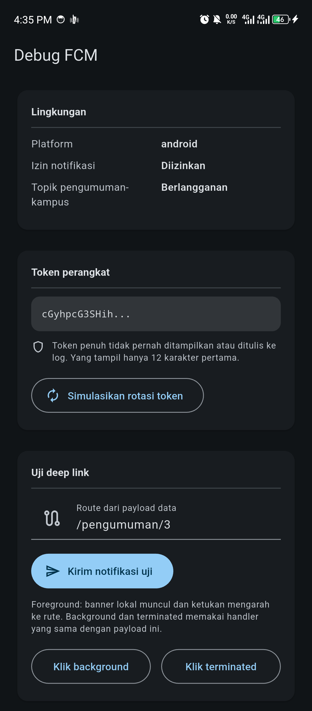
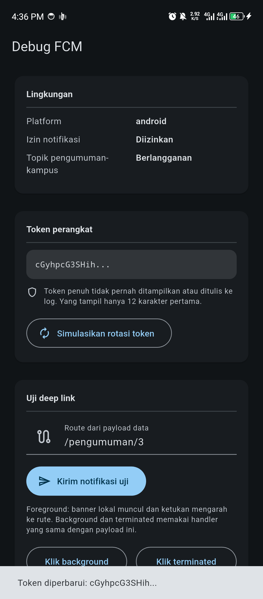
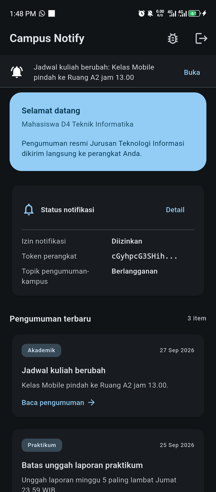
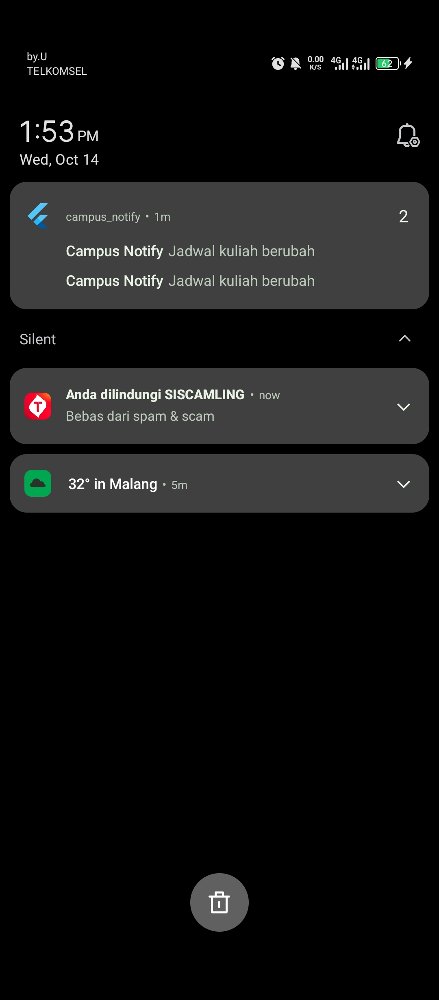
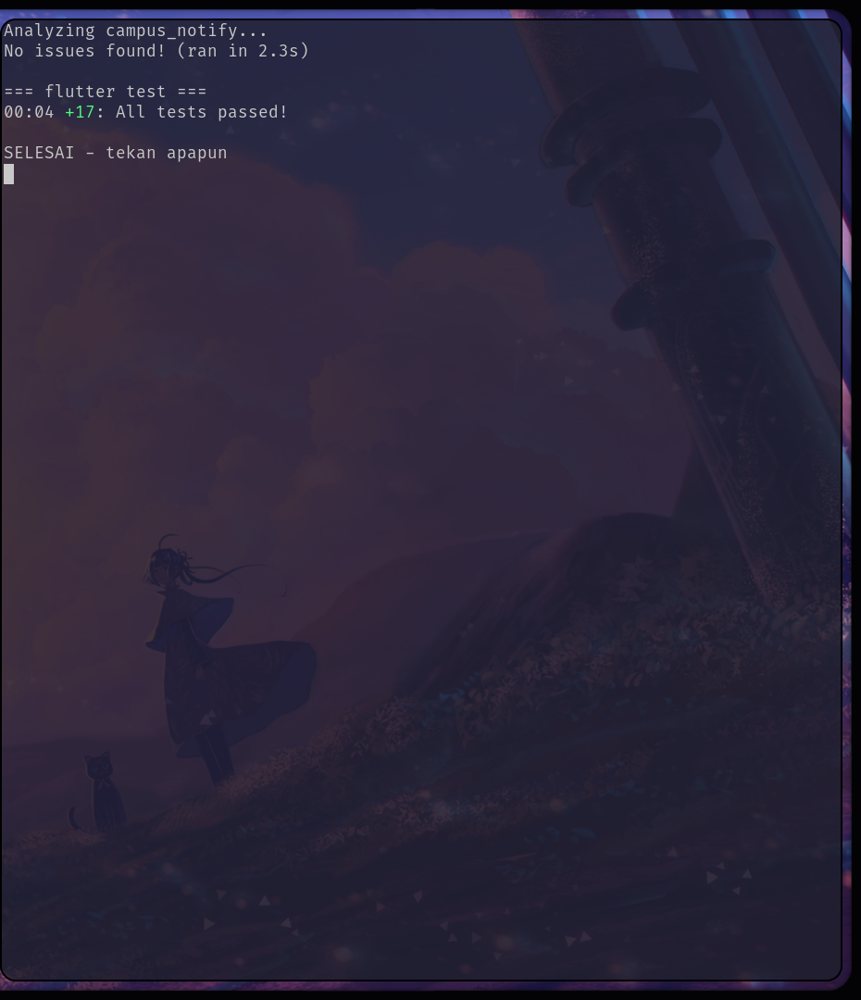

# 06 Week 6: Authentication, Security & FCM

Tugas minggu ke-6 mata kuliah Pemrograman Mobile (JTI Polinema). Proyek
**Campus Notify** menerapkan autentikasi dengan penyimpanan token yang aman,
refresh token otomatis, dan integrasi Firebase Cloud Messaging lengkap dengan
deep link ke halaman pengumuman.

## Tujuan

- Menjelaskan alur autentikasi dan perbedaan ID token, access token, serta
  refresh token.
- Menyimpan token di secure storage dan menerapkan refresh otomatis saat 401.
- Menjelaskan arsitektur FCM: app server, Firebase, dan perangkat.
- Meminta izin notifikasi serta mengelola token lifecycle (`getToken`,
  `onTokenRefresh`).
- Membedakan notification payload dan data payload pada tiga app state.
- Menangani klik notifikasi (deep link dengan GoRouter) dan topic messaging.
- Menerapkan prinsip keamanan dasar: tidak menyimpan secret di kode dan tidak
  menulis token penuh ke log.

## Fitur Utama

- **Login dengan guard route**: pengguna yang belum login selalu diarahkan ke
  `/login`, dan yang sudah login tidak bisa kembali ke `/login`.
- **Token di secure storage**: access dan refresh token hanya keluar-masuk lewat
  `TokenStore` (`flutter_secure_storage`), tidak pernah di `SharedPreferences`.
- **Refresh otomatis sekali**: interceptor Dio menukar refresh token saat
  menerima 401, mengulang request satu kali, dan memaksa logout bila refresh
  ikut gagal.
- **Siklus hidup token FCM**: minta izin, `getToken`, `onTokenRefresh` yang
  benar-benar dikirim ke backend (`POST /devices`), dan langganan topik
  `pengumuman-kampus`.
- **Deep link dari tiga app state**: `onMessage` (foreground, banner lokal
  manual), `onMessageOpenedApp` (background), dan `getInitialMessage`
  (terminated) semuanya menuju `/pengumuman/:id` yang sama.
- **Halaman Debug** menampilkan token terpotong, tombol rotasi token, dan
  simulasi klik untuk tiap state.
- **17 test lulus** untuk parsing rute, masking token, repository auth, dan
  status login tanpa Firebase sungguhan.

## Stack Teknologi

- Flutter 3.44 (Dart 3.12)
- `flutter_riverpod` ^3
- `go_router` ^18
- `dio` ^5
- `flutter_secure_storage` ^11
- `firebase_core` ^4 + `firebase_messaging` ^16
- `flutter_local_notifications` ^22
- `flutter_test` untuk unit dan widget test

## Struktur Folder

```text
06-week-6-authentication-security-fcm/
├── campus_notify/              # Project Flutter yang dapat dijalankan
│   ├── lib/
│   │   ├── main.dart           # Firebase init + MaterialApp.router + guard + handler FCM
│   │   ├── routes.dart         # konstanta rute bersama GoRouter & FCM
│   │   ├── data/
│   │   │   ├── token_store.dart          # satu pintu token (secure storage)
│   │   │   ├── auth_repository.dart      # mock auth siap diganti Firebase Auth
│   │   │   ├── api_client.dart           # Dio + interceptor refresh 401
│   │   │   ├── api_errors.dart           # DioException -> pesan ramah
│   │   │   └── announcement_repository.dart
│   │   ├── providers/auth_provider.dart  # status login + status FCM
│   │   ├── messaging/
│   │   │   ├── push_service.dart         # permission, token, 3 handler, maskToken
│   │   │   └── route_parser.dart         # RemoteMessage -> route (fungsi murni)
│   │   └── pages/ (login_page, home_page, announcement_page, debug_page)
│   └── test/auth_push_test.dart
├── lib/                        # Salinan kode final (untuk portofolio)
├── test/                       # Salinan test final (untuk portofolio)
├── docs/
│   └── ai-challenge.md         # Prompt, output AI, verifikasi, keputusan final
├── screenshots/
└── README.md
```

> Kode yang dapat dijalankan ada di subfolder `campus_notify/`
> (di-ignore oleh Git). Folder `lib/` dan `test/` di root berisi salinan final
> untuk dokumentasi portofolio, mengikuti konvensi minggu sebelumnya.

## Alur Data

```text
UI (ConsumerWidget) --watch--> Provider Riverpod
AuthNotifier --login--> AuthRepository --simpan--> TokenStore (secure storage)
Request API --Dio interceptor--> 401? --refresh sekali--> retry / clear + login ulang
FCM --getToken/onTokenRefresh--> POST /devices (backend)
FCM --notification+data.route--> onMessage / onMessageOpenedApp / getInitialMessage
                                              |
                                              v
                                     GoRouter -> /pengumuman/:id
```

UI tidak pernah menyentuh secure storage atau Firebase langsung. Semua lewat
repository/provider, dan `RemoteMessage -> route` diekstrak ke fungsi murni
`routeFromMessage` agar dapat diunit-test.

## 1. Autentikasi & guard route

`AuthNotifier` membaca status login dari keberadaan access token di secure
storage, bukan flag di memori, sehingga sesi bertahan setelah aplikasi ditutup.
Guard `redirect` pada GoRouter memaksa `/login` selama token tidak ada.

<table>
  <tr>
    <td align="center"><strong>Halaman login</strong><br><br>
      </td>
    <td align="center"><strong>Validasi kredensial salah</strong><br><br>
      </td>
  </tr>
</table>

## 2. Token disimpan aman dan dipakai berulang

`TokenStore` adalah satu-satunya pintu token. Access token dipakai sebagai
`Authorization: Bearer` pada setiap request. Saat server membalas 401,
interceptor menukar refresh token, menyimpan access baru, dan mengulang request
tepat satu kali; bila refresh ikut gagal, sesi dibersihkan dan pengguna kembali
ke `/login`.

## 3. Beranda & pengumuman

Beranda menampilkan ringkasan status notifikasi (izin, token terpotong, topik)
dan daftar pengumuman. Kartu pengumuman membuka rute `/pengumuman/:id`.

<table>
  <tr>
    <td align="center"><strong>Beranda + status notifikasi</strong><br><br>
      </td>
    <td align="center"><strong>Daftar pengumuman</strong><br><br>
      </td>
    <td align="center"><strong>Detail `/pengumuman/3`</strong><br><br>
      </td>
  </tr>
</table>

## 4. Token lifecycle dan halaman Debug

Halaman Debug menampilkan token terpotong (12 karakter pertama + `...`), tombol
**Simulasikan rotasi token** yang memicu jalur `onTokenRefresh` dan mengirim
token baru ke `POST /devices`, serta tombol uji deep link untuk ketiga state.

<table>
  <tr>
    <td align="center"><strong>Token terpotong</strong><br><br>
      </td>
    <td align="center"><strong>Rotasi token -> dikirim ke backend</strong><br><br>
      </td>
  </tr>
</table>

## 5. Tiga app state (deep link `/pengumuman/:id`)

Payload gabungan `notification + data` dipakai untuk semua state:

```json
{
  "notification": { "title": "Jadwal kuliah berubah", "body": "Kelas Mobile pindah ke Ruang A2 jam 13.00" },
  "data": { "route": "/pengumuman/3", "id": "3" }
}
```

Pengujian dilakukan di **perangkat fisik** dengan
mengirim pesan dari **Firebase Console → Messaging** ke FCM registration token
perangkat. Pesan memakai payload gabungan `notification + data` di atas.


> Catatan pengujian: untuk state **terminated**, aplikasi dimatikan lewat
> recent-apps/`am kill`. Jangan pakai `adb shell am force-stop` karena Android
> menandai aplikasi `stopped` dan **memblokir** pengiriman FCM sampai aplikasi
> dibuka lagi. Deep link `/pengumuman/3` dibuktikan lewat halaman Debug
> (tombol *Klik background*/*Klik terminated*) yang memakai `routeFromMessage`
> dan router yang sama dengan handler FCM.

<table>
  <tr>
    <td align="center"><strong>Foreground: banner lokal</strong><br><br>
      </td>
    <td align="center"><strong>Background: klik notifikasi</strong><br><br>
      </td>
  </tr>
</table>

> Handler background adalah fungsi top-level `firebaseMessagingBackgroundHandler`
> dengan `@pragma('vm:entry-point')`. Ia berjalan di isolate terpisah sehingga
> tidak menyentuh `BuildContext`/Riverpod; navigasi dilakukan saat pengguna
> mengetuk notifikasi.

### Bukti uji dari Firebase Console

Notifikasi di atas dikirim lewat Firebase Console → Messaging (campaign dengan
`title`, `body`, dan custom data `route`/`id`) ke token perangkat.

<p align="center">
  
</p>

## 6. Topic messaging

`subscribeToTopic('pengumuman-kampus')` dipanggil setelah token terkirim, dan
`unsubscribeFromTopic` tersedia untuk berhenti. Aturan: topik untuk broadcast
(semua mahasiswa, satu kelas), token perangkat untuk pesan personal (nilai,
tagihan).

## Testing

```bash
cd campus_notify
flutter analyze
flutter test --concurrency=1
```

Hasil:

```text

<p align="center">
  
</p>

## Cara Menjalankan

```bash
cd campus_notify
flutter pub get
flutter run                 # Android/iOS (FCM sungguhan, butuh google-services.json)
```

Aplikasi membuka **/login**. Kredensial demo sudah terisi
(`mahasiswa@jti.polinema.ac.id` / `rahasia123`). Setelah masuk, ikon gerigi
membuka halaman Debug, dan menekan kartu pengumuman membuka `/pengumuman/:id`.

**Setup Firebase (Android/iOS).** Buat project di Firebase Console, tambahkan
aplikasi Android dengan package name sesuai `applicationId`, lalu letakkan
`google-services.json` di `android/app/`. Terapkan plugin `google-services` dan
dependensi yang diminta. Untuk iOS tambahkan `GoogleService-Info.plist` dan
aktifkan Push Notification capability. Tanpa langkah ini aplikasi tetap berjalan,
tetapi `getToken` mengembalikan `null` (dicatat sebagai peringatan, bukan crash).

## AI Verification Checklist

| Item | Status | Catatan |
| :--- | :---: | :--- |
| Background handler top-level dengan `@pragma('vm:entry-point')`? | ✅ | `firebaseMessagingBackgroundHandler`, bukan method kelas |
| `onTokenRefresh` mengirim token baru ke backend? | ✅ | Callback `onToken` menulis `POST /devices`, bukan sekadar log |
| Foreground memakai local notification manual? | ✅ | `flutter_local_notifications` di `onMessage` |
| Klik dari ketiga state masuk rute yang benar? | ✅ | Tabel pengujian + screenshot 08-10 |
| Token/secret tidak di-hardcode dan tidak di-log penuh? | ⚠️ Diperbaiki | Token di-mask `maskToken`, log hanya 12 karakter |
| `flutter analyze` dan `flutter test` lolos | ✅ | `flutter analyze` bersih, 17 test lulus |

## Checklist Verifikasi Mandiri

- [x] Token hanya di `flutter_secure_storage`, tidak di SharedPreferences/log/
      screenshot penuh.
- [x] 401 memicu refresh sekali lalu retry; refresh mati memaksa login ulang.
- [x] Ketiga app state teruji dengan tabel bukti; klik masuk ke rute yang benar.
- [x] Topik untuk broadcast, token untuk pesan personal.
- [x] `flutter analyze` bersih dan semua test lulus.

## Refactoring Challenge

1. **`lib/routes.dart`** memuat seluruh konstanta rute (`/login`,
   `/pengumuman/:id`), dipakai bersama oleh GoRouter dan deep link FCM.
2. **`routeFromMessage`** di `lib/messaging/route_parser.dart` adalah fungsi
   murni `Map<String, dynamic> -> route` yang diunit-test tanpa Firebase.
3. **`lib/data/api_errors.dart`** memetakan `DioException` menjadi pesan ramah
   (401, timeout, offline), sehingga UI hanya menerima pesan.

## Refleksi

1. **Mengapa refresh token tidak boleh di SharedPreferences?** SharedPreferences
   menyimpan teks polos. Bila perangkat di-root atau data dicadangkan, refresh
   token bocor dan penyerang bisa menerbitkan access token baru tanpa kata sandi.
   Secure storage memakai Keystore/Keychain yang terenkripsi.
2. **Apa yang rusak bila `onTokenRefresh` diabaikan satu semester?** Backend
   menyimpan token basi setelah reinstall, clear data, atau rotasi keamanan.
   Notifikasi berhenti sampai ke perangkat tanpa error yang terlihat.
3. **Kapan topik, kapan token perangkat?** Topik untuk broadcast ke banyak
   pengguna (pengumuman kampus, satu kelas). Token perangkat untuk pesan
   personal (nilai, tagihan) yang tidak boleh dibaca orang lain.
4. **Bagian hasil AI yang diperbaiki?** Lihat
   [`docs/ai-challenge.md`](docs/ai-challenge.md): menambahkan jalur
   `onTokenRefresh` nyata ke backend, `@pragma('vm:entry-point')` pada handler
   background, dan masking token.
