# 07 Week 7: Clean Architecture

Tugas minggu ke-7 mata kuliah Pemrograman Mobile (JTI Polinema). Proyek ini
adalah **refactor** project Minggu 5 (`week5_offline_notes`) menjadi struktur
**feature-first Clean Architecture** dengan tiga lapisan terpisah
(presentation, domain, data). Tampilan dan perilaku aplikasi **identik** dengan
Minggu 5; yang berubah adalah struktur folder dan arah dependensi.

## Tujuan

- Menjelaskan prinsip SOLID dan separation of concerns dengan contoh kode Flutter.
- Membedakan struktur feature-first vs layer-first beserta trade-off-nya.
- Menjelaskan tiga layer (presentation, domain, data) dan aturan dependensi
  (dependensi mengarah ke dalam).
- Membedakan entity vs model serta peran repository, use case, dan dependency injection.
- Merefactor project Minggu 5 menjadi struktur feature-first yang terpisah layer-nya.
- Menguji use case dengan repository palsu tanpa database atau jaringan sungguhan.

## Fitur Utama

- **Catatan offline (SQLite)**: CRUD catatan persisten, diurutkan `updated_at`
  terbaru, dengan badge "Belum tersinkron" (dirty flag).
- **Sinkronisasi**: use case `SyncNotes` yang memiliki logika nyata (hitung
  catatan dirty, simulasi upload, tandai bersih hanya bila sukses).
- **Cache-first read** untuk `GET /posts` JSONPlaceholder: cache lokal tampil
  seketika, refresh jaringan di background, hasil disimpan ke tabel `cached_posts`.
- **Simulasi offline deterministik** lewat toggle `forceOffline` (provider).
- **Preferensi** (tema gelap/terang + waktu terakhir dibuka) lewat
  `SettingsRepository` + `SharedPreferences`.
- **Halaman detail catatan** `/note/:id` dengan GoRouter yang membaca langsung
  dari repository lokal.
- **10 test lulus** (use case dengan repository palsu, model, dan widget) tanpa
  SQLite/Dio sungguhan.

## Stack Teknologi

- Flutter 3.44 (Dart 3.12)
- `flutter_riverpod` ^3
- `sqflite` ^2 + `path`
- `shared_preferences` ^2
- `dio` ^5
- `go_router` ^18
- `flutter_test` untuk unit dan widget test

## Arsitektur: Tiga Layer & Arah Dependensi

Aturan emas (**dependency rule**): dependensi hanya mengarah **ke dalam**.
`domain` tidak tahu apa pun tentang Flutter, Dio, atau SQLite sehingga logika
bisnis bisa diunit-test murni.

```text
presentation (widget, notifier, router)
      |
      v  bergantung ke
domain (entity, repository interface, use case, failure)
      ^
      |  diimplementasikan oleh
data (model, repository impl, Dio, SQLite, secure storage)
```

### Struktur Folder (feature-first)

```text
07-week-7-clean-architecture/
├── lib/
│   ├── core/                       # Murni Dart, tanpa framework
│   │   ├── failures.dart           # Failure, LocalFailure, NetworkFailure
│   │   └── format.dart             # formatDateTime, parseNoteId (fungsi murni)
│   ├── infra/                      # Pembungkus framework, dipakai lapisan data
│   │   ├── database.dart           # openNotesDb (SQLite)
│   │   └── network.dart            # Dio + mapDioError
│   ├── features/
│   │   ├── notes/
│   │   │   ├── domain/
│   │   │   │   ├── entities/note.dart
│   │   │   │   ├── repositories/note_repository.dart      # interface
│   │   │   │   └── usecases/  (get_notes, get_note, add_note, delete_note, sync_notes)
│   │   │   ├── data/
│   │   │   │   ├── models/note_model.dart                 # mapping toMap/fromMap
│   │   │   │   └── repositories/note_repository_impl.dart
│   │   │   └── presentation/
│   │   │       ├── providers/notes_providers.dart         # wiring DI
│   │   │       ├── pages/ (notes_page, note_detail_page)
│   │   │       └── widgets/note_tile.dart
│   │   ├── posts/     {domain, data, presentation}
│   │   └── settings/  {domain, data, presentation}
│   ├── routes.dart                 # GoRouter + konstanta rute
│   └── main.dart
├── test/
├── docs/
├── screenshots/
└── README.md
```

### Peran setiap bagian

| Peran | Lokasi | Contoh |
| :--- | :--- | :--- |
| **Entity** | `domain/entities` | `Note`, `Post` (tanpa `toMap/fromMap/toJson`) |
| **Model** | `data/models` | `NoteModel`, `PostModel` (mapping ke entity lewat `toEntity()`) |
| **Repository interface** | `domain/repositories` | `NoteRepository`, `PostRepository` |
| **Repository impl** | `data/repositories` | `NoteRepositoryImpl` (SQLite), `PostRepositoryImpl` (Dio + SQLite) |
| **Use case** | `domain/usecases` | `GetNotes`, `AddNote`, `SyncNotes` |
| **DI** | `presentation/providers` | `noteRepositoryProvider`, `getNotesProvider`, `notesProvider` |

### Entity vs Model

`Note` adalah objek bisnis murni. `NoteModel extends Note` menambahkan
`toMap()`/`fromMap()` yang hanya hidup di lapisan `data`. Konversi ke entity
dilakukan eksplisit lewat `toEntity()` di batas data → domain, sehingga
presentation tidak pernah menerima model.

### Kapan use case dibuat, kapan tidak

- **Use case dibuat** saat operasi punya logika bisnis atau menggabungkan >1
  panggilan repository. Contoh: `SyncNotes` menghitung catatan dirty,
  menyimulasikan upload, lalu menandai bersih hanya bila sukses.
- **Repository langsung ke notifier** cukup untuk CRUD satu-baris. Operasi
  `getNotes`/`addNote`/`deleteNote` tetap dibungkus use case tipis agar
  presentasi bergantung pada operasi bisnis (bukan repository), tetapi
  `SettingsRepository` sengaja **tidak** dibungkus `Failure` karena nilainya
  primitif dan tanpa aturan bisnis. Keputusan ini dicatat di
  [`docs/ai-challenge.md`](docs/ai-challenge.md).

## Verifikasi Dependency Rule

Tiga pemeriksaan sterilitas, semuanya **nol hasil**:

```bash
# 1. Presentation steril dari data mentah (NOL hasil)
rg "Dio\(|openDatabase|getDatabasesPath|FlutterSecureStorage|SharedPreferences\.getInstance|jsonDecode" lib/features/*/presentation

# 2. Domain steril dari framework & package (NOL hasil)
rg "import 'package:flutter|import 'package:dio|import 'package:sqflite|import 'package:firebase" lib/features/*/domain lib/core

# 3. Static analysis + test
flutter analyze   # No issues found!
flutter test      # All tests passed! (10)
```

Hasil lengkap ketiga grep tersimpan di [`docs/verifikasi-grep.md`](docs/verifikasi-grep.md).

## Screenshots: Before (Minggu 5) vs After (Minggu 7)

Clean Architecture mengubah **struktur kode**, bukan tampilan. UI yang identik
adalah bukti bahwa refactor tidak merusak behavior. Screenshot "after" diambil
dari perangkat fisik (Infinix X6833B, Android 14).

### Daftar catatan offline

<table>
  <tr>
    <td align="center"><strong>Before (Minggu 5)</strong><br><br>
      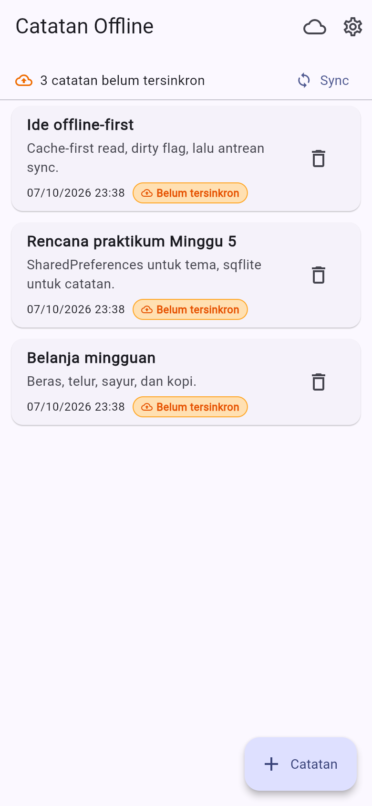</td>
    <td align="center"><strong>After (Minggu 7)</strong><br><br>
      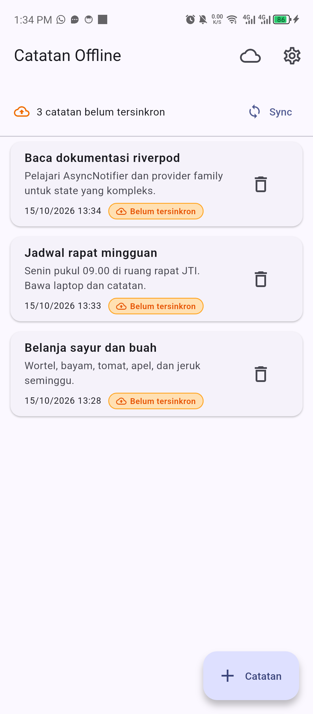</td>
  </tr>
</table>

### Badge dirty & tambah catatan

<table>
  <tr>
    <td align="center"><strong>Badge dirty (after)</strong><br><br>
      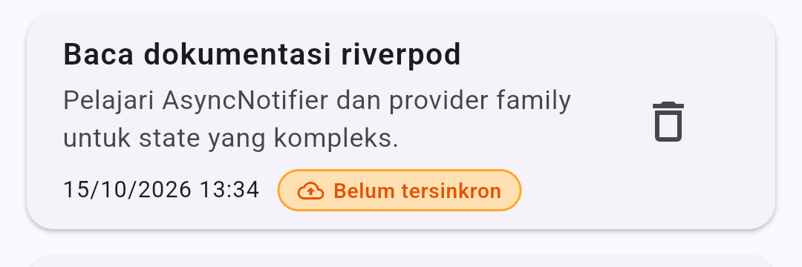</td>
    <td align="center"><strong>Tambah catatan (after)</strong><br><br>
      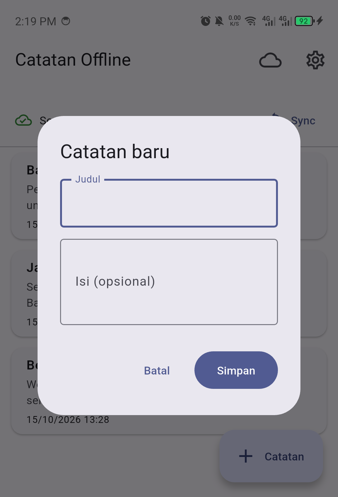</td>
    <td align="center"><strong>Detail catatan (after)</strong><br><br>
      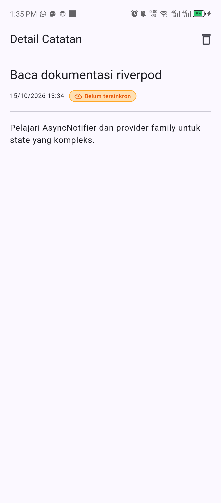</td>
  </tr>
</table>

### Sinkronisasi & mode offline

<table>
  <tr>
    <td align="center"><strong>Sync sukses (after)</strong><br><br>
      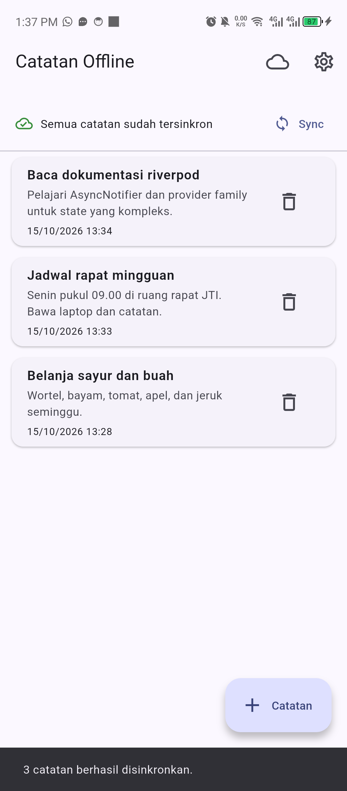</td>
    <td align="center"><strong>Mode offline (after)</strong><br><br>
      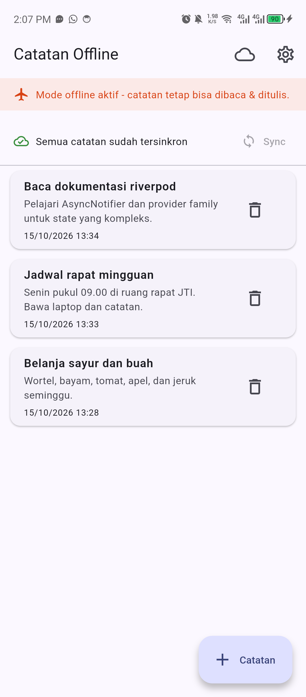</td>
  </tr>
</table>

### Preferensi

<table>
  <tr>
    <td align="center"><strong>Pengaturan terang</strong><br><br>
      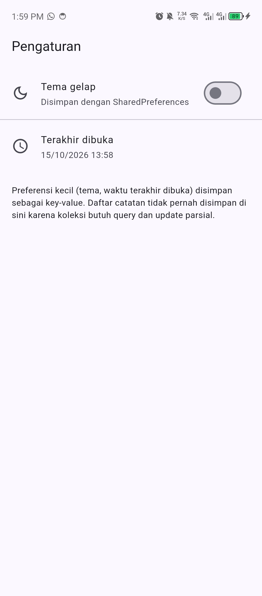</td>
    <td align="center"><strong>Pengaturan gelap</strong><br><br>
      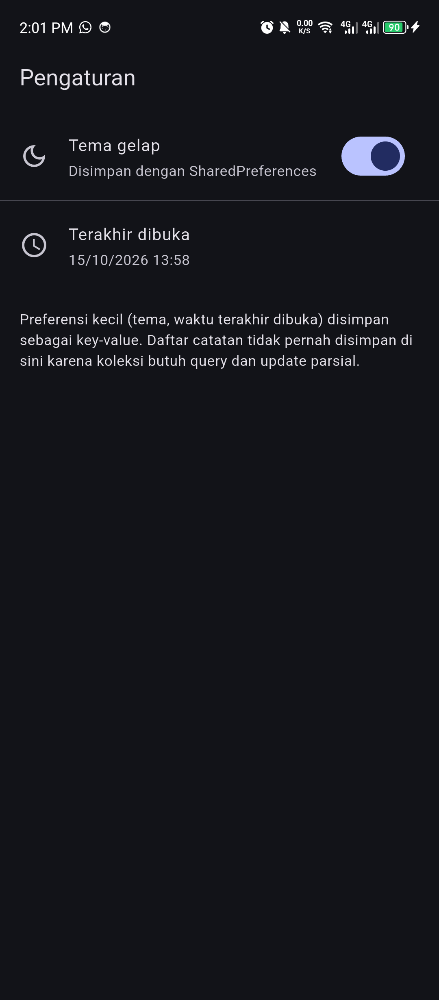</td>
  </tr>
</table>

### Cache-first read (data API)

<table>
  <tr>
    <td align="center"><strong>Dari cache lokal</strong><br><br>
      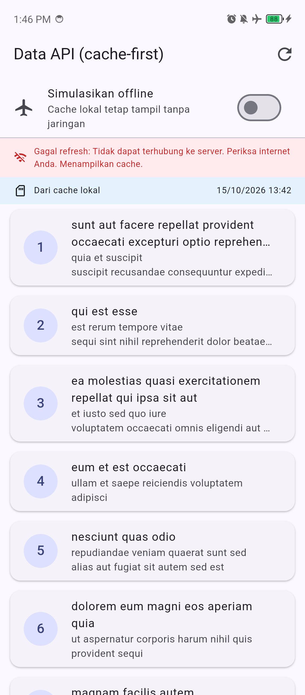</td>
    <td align="center"><strong>Dari jaringan</strong><br><br>
      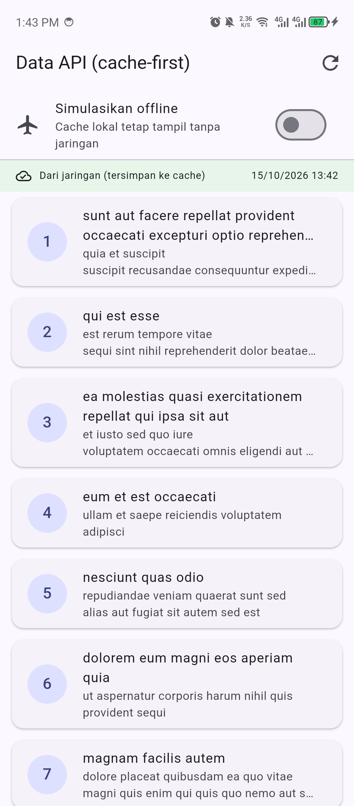</td>
    <td align="center"><strong>Refresh gagal, cache tetap tampil</strong><br><br>
      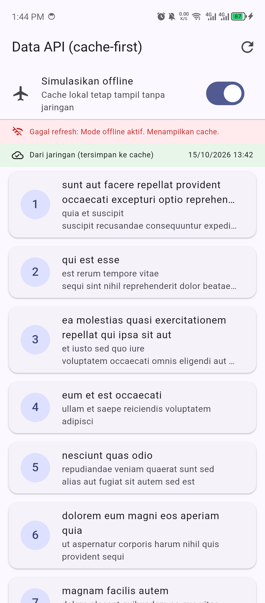</td>
  </tr>
</table>

### Hasil analisis & test

<p align="center">
  
</p>

## Testing

```bash
flutter analyze
flutter test
```

Test domain memakai **repository palsu** (`FakeNoteRepository`) sehingga tidak
membutuhkan SQLite/Dio sungguhan:

- `test/get_notes_test.dart` — `GetNotes` sukses + meneruskan failure.
- `test/sync_notes_test.dart` — `SyncNotes` menghitung, tidak menyentuh server
  saat nol dirty, dan meneruskan failure.
- `test/note_model_test.dart` — `fromMap` aman terhadap field hilang, flag dirty
  bertahan, `toEntity` menghasilkan entity murni.
- `test/note_tile_test.dart` — widget badge dirty.

## Cara Menjalankan

```bash
flutter pub get
flutter run                 # Android/desktop
```

Aplikasi membuka **Catatan Offline** (`/`). Ikon cloud membuka halaman Data API
(`/posts`), ikon gerigi membuka Pengaturan (`/settings`), dan menekan sebuah
catatan membuka detail (`/note/:id`).

## Refactoring Challenge

1. **Pola yang sama diterapkan ke tiga fitur** (`notes`, `posts`, `settings`):
   entity + repository interface + impl + use case + provider wiring. Tidak ada
   fitur yang bersih sementara sisanya kotor.
2. **Formatting tanggal & parsing rute diekstrak** ke fungsi murni di
   `lib/core/format.dart` (`formatDateTime`, `parseNoteId`) agar bisa diuji tanpa
   widget.
3. **Exception mentah dipetakan ke `Failure`** sebelum mencapai UI: `mapDioError`
   mengubah `DioException` menjadi `NetworkFailure` dengan pesan ramah; UI hanya
   menerima `message`.

## AI Verification Checklist

| Item | Status | Catatan |
| :--- | :---: | :--- |
| Interface repository di `domain`, impl di `data`? | ✅ | `note_repository.dart` vs `note_repository_impl.dart` terpisah |
| `domain` bebas import Flutter/Dio/SQLite/Firebase? | ✅ | Grep sterilitas #2 nol hasil |
| Use case per CRUD satu-baris (over-engineering)? | ⚠️ Disederhanakan | `SettingsRepository` tidak dibungkus `Failure`; CRUD tipis tetap dibungkus use case agar presentasi bergantung pada operasi bisnis |
| Entity bebas mapping? | ✅ | `toMap/fromMap/toJson` hanya di `NoteModel`/`PostModel` |
| Wiring DI terpusat di provider? | ✅ | Widget tidak `new Repository()`; semua lewat provider |
| `flutter analyze` dan `flutter test` lolos | ✅ | Bersih, 10 test lulus |

## Checklist Verifikasi Mandiri

- [x] Tiga grep sterilitas (presentation & domain) nol hasil.
- [x] Interface di domain, implementasi di data, mapping hanya di model.
- [x] Widget tidak menginstansiasi repository; semua lewat provider.
- [x] Aplikasi berjalan identik sebelum/sesudah refactor (bukti screenshot).
- [x] `flutter analyze` bersih dan semua test lulus.
- [x] Hasil AI diverifikasi dan didokumentasikan pada folder `docs/`.

## Refleksi

1. **Mengapa interface repository harus tinggal di domain, bukan di data?**
   Karena `domain` adalah pemilik aturan bisnis dan tidak boleh bergantung pada
   detail implementasi. Bila interface diletakkan di `data`, `domain` terpaksa
   mengimpor `data` (dependensi mengarah keluar), sehingga logika bisnis ikut
   terikat SQLite/Dio dan tidak bisa diuji murni.
2. **Kapan use case benar-benar dibutuhkan?**
   Saat operasi menggabungkan >1 repository atau punya aturan bisnis (validasi,
   sorting, sync), seperti `SyncNotes`. CRUD satu-baris boleh langsung repository
   → notifier.
3. **Apa biaya over-engineering use case per CRUD satu-baris?**
   Bagi tim kecil, setiap use case menambah file, boilerplate, dan lapisan yang
   harus dibaca tanpa manfaat nyata. Biayanya sepadan saat logika tumbuh atau
   saat beberapa sumber data digabung.
4. **Bagian usulan AI yang ditolak/disederhanakan?**
   Menolak pembungkusan `Failure` pada `SettingsRepository` (nilai primitif,
   tanpa aturan bisnis) dan menolak use case per operasi preferensi. Alasan
   lengkap di [`docs/ai-challenge.md`](docs/ai-challenge.md).
